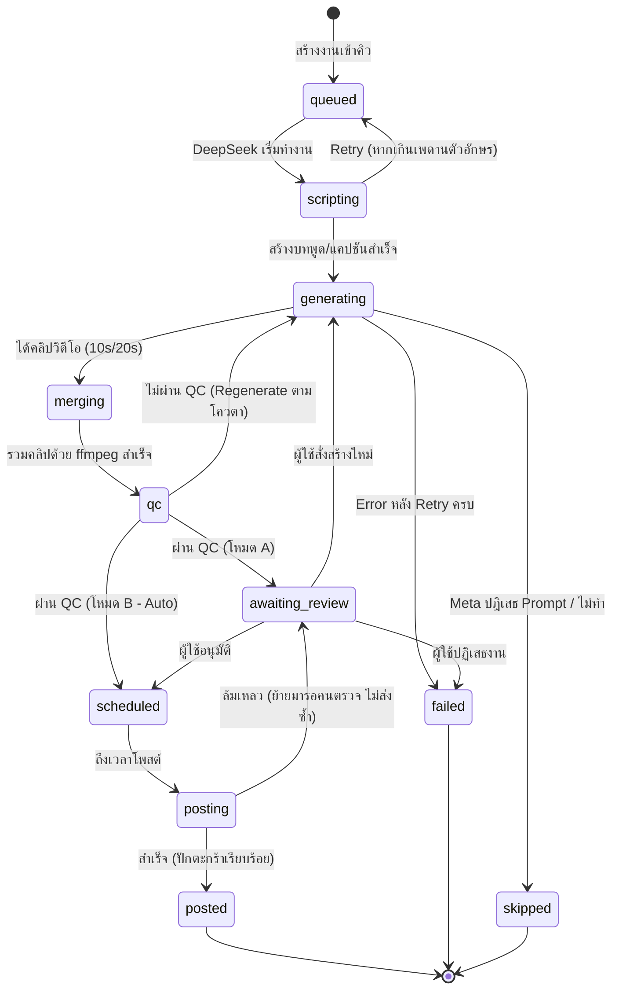

# เอกสารสถาปัตยกรรมระบบ (System Architecture Specification)
**โครงการ:** RUAYRUAY GROUP — TikTok Affiliate Showcase & Auto-Video Studio  
**เวอร์ชัน:** 2.0 (Chrome Extension Manifest V3)  
**สถานะ:** เสนอเพื่อขออนุมัติก่อนเริ่มพัฒนา (Awaiting User Approval)  
**วันที่บันทึก:** 2026-10-29  

---

## 1. แผนภาพสถาปัตยกรรมระบบโดยรวม (System Architecture)

```mermaid
flowchart TD
    subgraph UI_Layer ["🖥️ Presentation Layer (React + Vite + Tailwind)"]
        Dashboard["Dashboard (Tab เต็มหน้า)<br/>ภาพรวม, สินค้า, คิวงาน, Review, ปฏิทิน, ตั้งค่า"]
        SidePanel["Side Panel (ตัวควบคุมด่วนข้างจอ)<br/>เริ่ม/พัก/หยุดฉุกเฉิน, สถานะงาน, เตือนด่วน"]
    end

    subgraph Background_Layer ["⚙️ Background Service Worker (Central Brain)"]
        QueueMgr["Queue Manager (State Machine)"]
        JobLock["Job Lock & Tab Registry"]
        ScheduleEngine["Schedule Engine (ตาราง & Loop)"]
        DeepSeekSvc["DeepSeek API Client"]
        ShowcaseSvc["Showcase API Client (Session)"]
        AlarmMgr["Alarm Manager (chrome.alarms)"]
        NotiSvc["Notification Service (Chrome + Telegram)"]
    end

    subgraph Storage_Layer ["💾 Local Persistence Layer"]
        StorageLocal["chrome.storage.local (Settings, State)"]
        IndexedDBStore["IndexedDB (Products, Video Blobs, History)"]
    end

    subgraph Content_Adapters ["🤖 Automation Adapters (Content Scripts)"]
        MetaAi["MetaAiAdapter (สร้างวิดีโอตรง C)"]
        Flow["FlowAdapter (ภาพ A → วิดีโอ B)"]
        TikTok["TikTokStudioAdapter (โพสต์ + ปักตะกร้า)"]
        SelectorReg["Selector Registry (Config แยกต่อเว็บ)"]
    end

    subgraph Video_Processing ["🎬 Media Processing Layer"]
        MergeWorker["FFmpeg Merge Worker (ffmpeg.wasm)"]
        QCService["QC Validator (Duration, 9:16, Audio, Hash)"]
    end

    Dashboard <-->|chrome.runtime & storage event| QueueMgr
    SidePanel <-->|chrome.runtime & storage event| QueueMgr
    QueueMgr <--> StorageLocal
    QueueMgr <--> IndexedDBStore

    QueueMgr -->|สร้างสคริปต์| DeepSeekSvc
    QueueMgr -->|ดึงสินค้า| ShowcaseSvc
    QueueMgr -->|สั่งสร้างคลิป| MetaAi
    QueueMgr -->|สั่งสร้างคลิป| Flow
    QueueMgr -->|สั่งรวมคลิป| MergeWorker
    MergeWorker --> QCService
    QCService --> QueueMgr

    QueueMgr -->|สั่งโพสต์| TikTok
    ScheduleEngine -->|ปลุกตามเวลา| AlarmMgr
    QueueMgr -->|แจ้งเตือน| NotiSvc
    MetaAi & Flow & TikTok -.-> SelectorReg
```



---

## 2. โครงสร้างโมดูลและการแบ่งเลเยอร์ (Modular Structure)

เพื่อแก้ปัญหาไฟล์ขนาดใหญ่เกินไปแบบเดิม (`background.js` เดิม 205 KB) โครงการใหม่จะใช้ TypeScript Strict Mode แยกโมดูลขนาดเล็ก (ไม่เกิน 300–400 บรรทัดต่อไฟล์) โดยจัดโครงสร้างดังนี้:

```
src/
├── background/                     # Background Service Worker
│   ├── index.ts                    # Entry point & Message Router
│   ├── queue/                      # Finite State Machine & Job Runner
│   │   ├── queueManager.ts
│   │   ├── stateMachine.ts
│   │   └── jobLock.ts              # Single-tab execution lock
│   ├── scheduler/                  # ตารางเวลาและ Loop
│   │   ├── scheduleEngine.ts       # ตัวคำนวณเวลาและจัดสรรช่องว่าง
│   │   └── alarmManager.ts         # จัดการ chrome.alarms
│   ├── services/                   # External Services
│   │   ├── deepseekClient.ts       # DeepSeek API (JSON output + validation)
│   │   ├── showcaseClient.ts       # TikTok Showcase API (Session Cookie)
│   │   └── notificationService.ts  # Chrome notification & Telegram bot
│   └── storage/                    # Storage abstraction
│       ├── db.ts                   # IndexedDB wrapper (Products, Blobs)
│       └── settingsStore.ts        # chrome.storage.local
│
├── adapters/                       # Content Script Adapters
│   ├── baseAdapter.ts              # Base Interface & Step Verification
│   ├── selectorRegistry/           # คลัง Selector แยกรายเว็บ (ทนต่อ UI เปลี่ยน)
│   │   ├── metaAiSelectors.ts
│   │   ├── flowSelectors.ts
│   │   └── tikTokStudioSelectors.ts
│   ├── metaAiAdapter.ts            # Port จาก meta-ai-bot.js
│   ├── flowAdapter.ts              # Port จาก flow-bot.js
│   └── tikTokStudioAdapter.ts      # Port จาก tiktok-post-bot.js (รวมปักตะกร้า)
│
├── media/                          # การประมวลผลวิดีโอ
│   ├── videoMergeService.ts        # ffmpeg.wasm controller
│   ├── ffmpegWorker.ts             # Web Worker สำหรับประมวลผลวิดีโอ
│   └── qcValidator.ts              # ตรวจสอบสัดส่วน 9:16, ความยาว, เสียง
│
├── ui/                             # React + Tailwind Frontend (Glassmorphism & Bento Theme)
│   ├── common/                     # Design System Components (Frosted Glass Panels, Ambient Glow, Modals)
│   │   ├── Button.tsx
│   │   ├── Modal.tsx
│   │   ├── StatusBadge.tsx
│   │   ├── GlassCard.tsx
│   │   └── CollapsibleSidebar.tsx  # Toggle ย่อ/ขยาย Sidebar ได้อิสระ
│   ├── dashboard/                  # Dashboard หน้าเต็ม
│   │   ├── App.tsx
│   │   ├── tabs/
│   │   │   ├── OverviewTab.tsx     # ภาพรวม, กราฟ, ไฟสถานะระบบ
│   │   │   ├── ProductsTab.tsx     # สินค้า Showcase, เลือกชุดงาน
│   │   │   ├── QueueTab.tsx        # รายการงานและ Progress
│   │   │   ├── ReviewTab.tsx       # อนุมัติคลิป, แก้แคปชัน/เวลา
│   │   │   ├── ScheduleTab.tsx     # ปฏิทินและสถานะ Loop
│   │   │   ├── HistoryTab.tsx      # ประวัติการโพสต์
│   │   │   ├── HealthTab.tsx       # ตรวจสอบ Selector และ Debug Bundle
│   │   │   └── SettingsTab.tsx     # ตั้งค่าระบบครบทุกหมวด
│   └── sidepanel/                  # Side Panel ขนาดกะทัดรัดข้างจอ
│       └── SidePanelApp.tsx        # ตัวควบคุมด่วน (เริ่ม/พัก/หยุดฉุกเฉิน)
│
└── templates/                      # Prompt Templates โหมดมือถือสินค้า
    └── hands-warehouse/
        ├── image-prompt.txt        # ภาคผนวก A (ภาพ Flow)
        ├── flow-video-prompt.txt   # ภาคผนวก B (วิดีโอ Flow)
        └── meta-video-prompt.txt   # ภาคผนวก C (วิดีโอ Meta AI)
```

---

## 3. วงจรสถานะงาน (State Machine & Recovery)

งานแต่ละรายการจะถูกควบคุมด้วย State Machine ที่เข้มงวด สามารถกู้คืนสถานะได้เมื่อ Service Worker หยุดพักหรือเครื่องดับ:



### กลไกความปลอดภัยของ State Machine
1. **Idempotency Key:** สร้างจาก `SHA-256(product_id + batch_id + round_index)` ป้องกันการโพสต์คลิปเดิมซ้ำเด็ดขาด
2. **Crash Recovery:** เมื่อ Service Worker ตื่นขึ้นมาใหม่ หากพบงานในสถานะ `generating` หรือ `posting` ค้างอยู่ จะตรวจสอบแท็บเป้าหมายก่อน และกู้สถานะกลับมาตามจุดล่าสุด (เช่น หากคลิปเสร็จแล้วจะดึงเข้า QC ทันที)

---

## 4. ผลการตรวจสอบขอบเขตการตั้งเวลาของ TikTok Studio (ตามหัวข้อ 4.7.4)

จากการตรวจสอบโค้ดเดิมใน `tiktok-post-bot.js` และโครงสร้างปฏิทินของ TikTok Studio จริง:

1. **ขอบเขตเวลาที่ TikTok Studio Native รองรับ:**
   - **ล่วงหน้าขั้นต่ำ:** ประมาณ **15 – 20 นาที** ขึ้นไปจากเวลาปัจจุบัน (ไม่สามารถตั้งเวลาที่กระชั้นชิดกว่า 15 นาทีได้)
   - **ช่วงนาที:** ปฏิทินบังคับขั้นละ **5 นาที** (เช่น 10:00, 10:05, 10:10)
   - **ล่วงหน้าสูงสุด:** ประมาณ **7 – 10 วัน** (วันหลังจากนั้นในปฏิทินจะถูก disable)
2. **การเลือกวิธีโพสต์อัตโนมัติ (Method 1 vs Method 2):**
   - **วิธีที่ 1 (TikTok Native Schedule):** เมื่อเวลาเป้าหมายอยู่ในช่วง **> 20 นาที และ ≤ 7 วัน** -> ระบบจะส่งคำสั่งตั้งเวลาผ่าน TikTok Studio โดยตรง (ข้อดี: ปิดเครื่องได้เลย)
   - **วิธีที่ 2 (Internal Queue with Alarms):** เมื่อเวลาเป้าหมาย **เกิน 7 วัน** หรือเป็นงานคิวที่สร้างคลิปไว้ก่อนเพื่อรอโพสต์ใน 1–2 สัปดาห์ข้างหน้า -> Extension จะเก็บงานไว้ในคิวภายใน และใช้ `chrome.alarms` ปลุกขึ้นมาโพสต์เมื่อถึงเวลา (ข้อจำกัด: ต้องเปิดเครื่องทิ้งไว้ และระบบจะแสดงป้ายเตือนชัดเจนใน UI)

---

## 5. การวิเคราะห์และข้อเสนอแนะเกี่ยวกับ Prompt ภาคผนวก C (Meta AI)

Prompt C ในภาคผนวกมีข้อความยาวมาก (ประมาณ 2,500 ตัวอักษร):
1. **การทดสอบใน Phase 4:** เราจะทดสอบส่ง Prompt C ฉบับเต็ม 100% ตามข้อกำหนดก่อน หาก Meta AI ประมวลผลและไม่ตัดทอน จะใช้ตัวเต็มเป็นหลัก
2. **เวอร์ชันกระชับสำรอง (Compact Fallback):** หากช่องพิมพ์ของ Meta AI เกิดการตัดทอนหรือปฏิเสธคำขอ เราได้เตรียมโครงสร้างตัดคำซ้ำซ้อนออก แต่ยังคงข้อห้ามสำคัญครบถ้วน:
   - ห้ามใบหน้า/ร่างกาย (เห็นเฉพาะมือผู้หญิงสองข้าง)
   - ป้าย A4 ขาวข้างสินค้า พร้อมข้อความ `{{SIGN_TEXT}}` ตรงตัว
   - สินค้าห้ามหมุน/ห้ามเปลี่ยนรูปทรง
   - ฉากหลังโกดังสินค้าชัดลึก
   - เสียงพากย์หญิงไทยตาม `{{VOICE_BLOCK}}` ปิดท้ายด้วย CTA
   *(โดยจะนำผลการทดสอบจริงมาแสดงให้คุณอนุมัติก่อนตัดสินใจ)*
